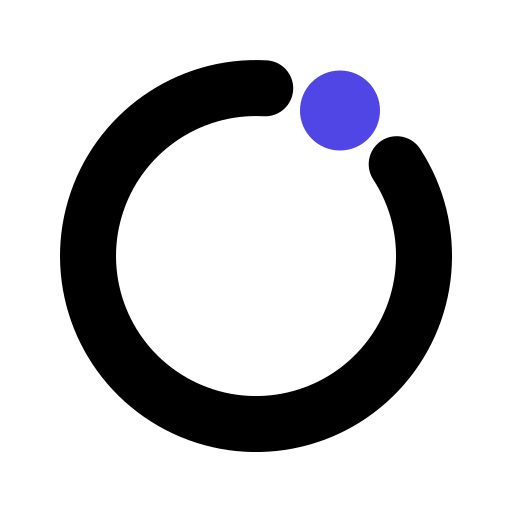
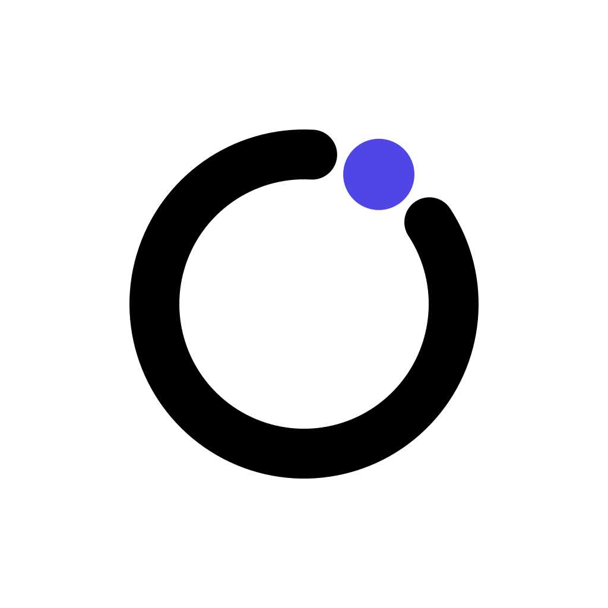
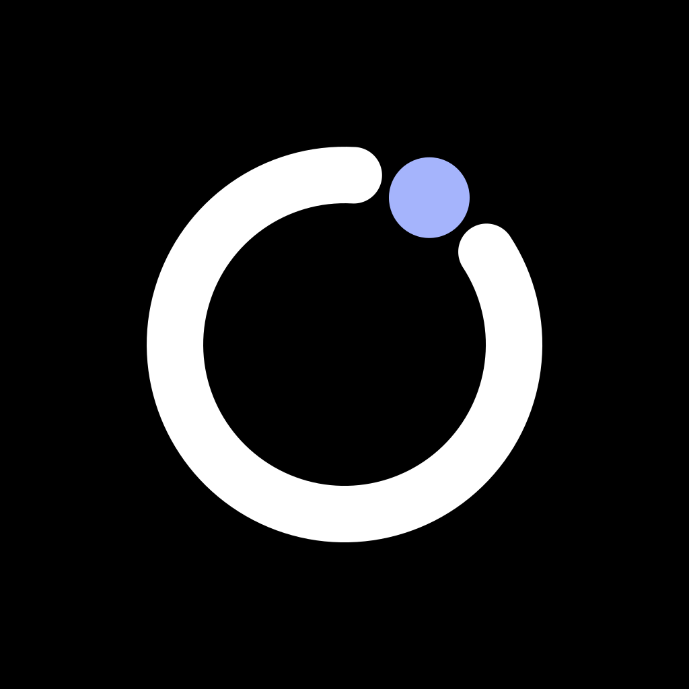

# Goodhour brand kit

The product is called **Goodhour** ([ADR 0010](../adr/0010-product-name-goodhour.md)). This kit sits on top of the A3 visual direction ([ADR 0009](../adr/0009-visual-direction-a3.md)): black and white, one indigo accent for what waits on the user, SF Pro with New York for warmth. Nothing here changes the app's colors; it names them and extends them to the logo, the icon and the web.

Files:

- [`goodhour-mark.svg`](goodhour-mark.svg): the mark, light and dark (follows `prefers-color-scheme`).
- [`goodhour-lockup.svg`](goodhour-lockup.svg): mark and wordmark. The wordmark is live text; see [Wordmark](#wordmark-and-lockup).
- [`goodhour-app-icon.svg`](goodhour-app-icon.svg), [`goodhour-app-icon-dark.svg`](goodhour-app-icon-dark.svg): 1024 × 1024 icon art.

## Name

- Write **Goodhour**: one word, capital G only. Never GoodHour, Good Hour or GOODHOUR.
- Lowercase `goodhour` appears only in the wordmark, domains and identifiers.
- It is named after the one number the app optimizes: good dates per hour of your time.
- The home-screen name is Goodhour (8 characters, never truncated).
- Line, when one is needed: **More good dates per hour.**

## Mark



An hour ring with one dot at one o'clock. The ring is an hour of your time; the dot is the good date in it.

- It is the same ring that drains on a planned send until its send time (ADR 0009, Motion), so the logo and the app's motion share one shape.
- The dot is the only accent. That keeps ADR 0009's rule: indigo marks only what waits on you.
- Geometry, on a 512 grid: ring radius 168, stroke 56, round caps. Dot radius 40, centred on the ring at 30°. The ring stops 3.5° short of the dot on each side.
- Clear space: one dot diameter (80 units) on every side.
- Smallest size: 20 px. Below that (a 16 px favicon), close the gap and draw a full ring with the dot on top.
- One-color use (engraving, a tinted icon, a fax): the dot takes the ring's color.
- Don't rotate the mark, move or add dots, outline it, fill it with a gradient, or put it straight on a photo. Over a photo it sits on a glass plate, like the text plates in ADR 0009.
- Considered and dropped (2026-11-26):
  - **Closed orbit:** a full ring with the dot sitting on it. Kept only as the 16 px favicon.
  - **Hour hand:** too literal, and the hand and dot merge at 20 px.
  - **Draining ring:** reads as a progress indicator. It stays the planned-send animation, not the logo.

## Wordmark and lockup


- `goodhour`, lowercase, in **Newsreader SemiBold (600)**, tracking −2%.
- Newsreader (Production Type, SIL Open Font License) is an optically sized transitional serif, close to New York. It is free to ship on the web, in App Store art and in print.
- Don't set the wordmark in New York or SF Pro. Apple licenses both only for UI on Apple platforms, which rules out a logo on the web or in print.
- Lockup: mark on the left. The mark's diameter spans the wordmark from ascender to descender. The gap is 0.3 × the mark's diameter.
- `goodhour-lockup.svg` uses live text, so it renders in a fallback serif where Newsreader is not installed. Before the lockup ships anywhere but these docs, convert the text to outlines in Newsreader SemiBold.
- Use the mark alone where the lockup does not fit (tab bar, favicon, avatar). Use the wordmark alone only where the mark already shows nearby.

## Color

The app's tokens, unchanged. The Swift names are those in `ios/DatingCRM/Components/Palette.swift` on the redesign branch. Contrast ratios are WCAG 2.

| Token | Light | Dark | Use | Contrast |
| --- | --- | --- | --- | --- |
| `ink` | `#000000` | `#FFFFFF` | Mark ring, wordmark, primary capsule (`.primary` in the app) | 21:1 |
| `paper` | `#FFFFFF` | `#000000` | Backgrounds, the icon field | |
| `text` | `#0B0B0F` | `#F5F5F7` | Body text on the web | 19.6:1 light |
| `secondaryText` | `#6C6C70` | `#98989F` | Metadata, times, captions | 5.2:1 / 7.3:1 |
| `accent` | `#4F46E5` | `#A5B4FC` | The dot; what waits on the user | 6.3:1 on white / 10.5:1 on black |
| `accentSoft` | `#EEF0FF` | `#1E1B4B` | Behind monograms and accent tiles | accent on it: 5.6:1 / 8.0:1 |
| `line` | `rgba(60,60,67,.18)` | `rgba(235,235,245,.16)` | Hairline separators | |

Rules:

- Indigo never lands on buttons, links or the selected tab, in the app or on the web. Primary buttons are ink capsules.
- One accent element per view in marketing too: the dot in the mark counts as that view's one accent.
- Never put `#4F46E5` on black (3.3:1). On dark surfaces use `#A5B4FC`.
- No gradients except the in-app color field behind Today's counter (ADR 0009).

For the web app:

```css
:root {
  --ink: #000; --paper: #fff; --text: #0B0B0F; --text-2: #6C6C70;
  --accent: #4F46E5; --accent-soft: #EEF0FF; --line: rgba(60, 60, 67, .18);
}
@media (prefers-color-scheme: dark) {
  :root {
    --ink: #fff; --paper: #000; --text: #F5F5F7; --text-2: #98989F;
    --accent: #A5B4FC; --accent-soft: #1E1B4B; --line: rgba(235, 235, 245, .16);
  }
}
```

## Typography

| Where | UI text | Serif (explanations, empty states, monograms, headlines) |
| --- | --- | --- |
| iOS app | SF Pro, Dynamic Type styles | New York (ADR 0009) |
| Web app | `system-ui, -apple-system, "Segoe UI", Roboto, sans-serif` | `ui-serif, Newsreader, Georgia, serif` |
| Marketing, App Store art, print | Inter or the system font | Newsreader |

- `system-ui` and `ui-serif` render SF Pro and New York on Apple devices without shipping the font files. Other browsers get Newsreader, self-hosted.
- Never serve SF Pro or New York font files from the web app.
- Sentence case everywhere: titles, buttons, tabs.
- Times and counters use tabular figures (`.monospacedDigit()` in SwiftUI, `font-variant-numeric: tabular-nums` on the web).

## App icon

 

- Build it in Icon Composer as a layered iOS 26 icon. Use three layers: the paper field, the ring and the dot.
- Default appearance: white field, black ring, `#4F46E5` dot ([`goodhour-app-icon.svg`](goodhour-app-icon.svg)).
- Dark appearance: black field, white ring, `#A5B4FC` dot ([`goodhour-app-icon-dark.svg`](goodhour-app-icon-dark.svg)).
- Tinted and clear appearances: the system derives them from the layers. Keep the dot on its own layer so it stays a separate value when tinted, and so Liquid Glass catches it as its own object.
- The ring's outer diameter is 588 of 1024 (57%). That stays inside the 80% safe zone of maskable web icons.
- Leave out text, hearts, flames and chat bubbles.
- Web: use the same art for `apple-touch-icon` (180 px) and the maskable PWA icons (192 and 512 px). The favicon is `goodhour-mark.svg`, which already follows the dark-mode media query.

## Voice and tone

Goodhour sounds like a calm friend who keeps your calendar: brief, warm and exact. It respects the user's time and the matches' dignity.

1. **Short and plain.** One idea per sentence. Sentence case. No exclamation marks and no emoji in product copy.
2. **Glossary words only.** Say match, card, draft, Send, Copy, handover, Review, Pipeline, Today, Pause, Copilot, Autopilot and Full autopilot. Never use the synonyms [`GLOSSARY.md`](../../GLOSSARY.md) marks _Avoid_: lead or contact for a match, inbox, kill switch, escalation, mode, approve. "Hot lead" is a glossary term and stays.
3. **Matches are people.** Call them by first name. Never target, prospect, score, game, rizz, close or conquest. Copy never rates looks or bodies.
4. **Honest about the AI.** Say who did what: "Autopilot sent this at 21:14." Copy never hides that Goodhour wrote or sent a message, and never offers a flat denial of being AI (spec, Handover triggers). Where the law requires disclosure, it takes one plain sentence.
5. **Respect time.** No streaks, guilt, fear of missing out or fake urgency. Notify only about what waits on the user, the same rule as the accent. Celebrate outcomes (a good date), not activity (messages sent).
6. **Exact.** Numbers as numerals, times in the user's clock and time zone, money with its currency.
7. **Errors say what happened and what to do next.** No blame and no jokes.
8. **Marketing leads with the outcome, then the control.** Fewer, better dates; you set how much it does alone, job by job. Never promise dates or matches. Never knock a dating app by name.

| Do | Don't |
| --- | --- |
| Maya replied. Your draft is ready. | 🔥 Maya is into you! Close the deal! |
| Autopilot paused this chat: Maya asked if she's talking to a bot. | Handled it. She'll never know 😉 |
| 3 waiting for you | You have 3 URGENT tasks!! |
| Nothing waiting. Enjoy your evening. | Inbox zero! Keep your streak alive! |
| Tinder signed you out. Reconnect it to keep autopilot running. | Oops! Something went wrong. |

## Moving off crm.mithrandir.one

The API deploys to the placeholder host `crm.mithrandir.one` (PR #77). Domains checked on 2026-11-25:

- **Free:** `goodhour.ai`, `goodhourapp.com`, `trygoodhour.com`, `goodhour.dating`.
- **Taken:** `goodhour.com` is registered but serves no site, so a broker may get it. `goodhour.app` is taken.
- **Suggestion:** register `goodhourapp.com`, plus `goodhour.ai` if the budget allows. Serve the API at `api.<domain>` and keep the root for the web app.

Do these in order:

1. **Trademark search.** Run a knock-out search for "Goodhour" at the USPTO and EUIPO (classes 9, 42 and 45), then buy the domain.
2. **DNS.** Add an `A` record for `api.<domain>` pointing at `74.208.250.12`. Keep `crm.mithrandir.one` until every signed-in iPhone has moved.
3. **Caddy.** On the VPS, add an `api.<domain>` site block to the Caddyfile, the same as the one in `docs/deploy.md`. Caddy fetches the certificate on the first request. To move old clients, set `crm.mithrandir.one { redir https://api.<domain>{uri} 308 }`. Use 308, not `permanent` (301), so `POST` stays `POST`.
4. **CI.** In `.github/workflows/ci.yml`, change `PUBLIC_URL: https://crm.mithrandir.one` (line 61 on `claude/deploy-pipeline`). The post-deploy health check uses it.
5. **`docs/deploy.md`.** Update lines 3 and 8 (host), 20–21 (Caddy comment and site block), 33 (DNS record) and 59 (`GOOGLE_REDIRECT_URI`).
6. **Google Calendar.** Set `GOOGLE_REDIRECT_URI=https://api.<domain>/calendar/callback` in the VPS `.env`. In the Google Cloud OAuth client, add the new URI to the authorized redirect URIs. On the consent screen, set the app name to Goodhour and add the logo and homepage.
7. **iOS server URL.** The app has no hard-coded server URL: the user types it on Sign in. Change the placeholder `https://crm.example.com` in `ios/DatingCRM/Screens/SignInView.swift:15`. Signed-in iPhones keep the old URL under the `serverURL` key in `UserDefaults`. They keep working through the redirect in step 3, or after a sign-out and sign-in.
8. **iOS names.** Set the display name (`CFBundleDisplayName`) to Goodhour; the share sheet shows it too. Change the bundle ID `com.datingcrm.app`, app group `group.com.datingcrm.app` and keychain group to the reversed new domain, such as `com.goodhourapp.app`. Do this before the first TestFlight upload: after that, the App Store Connect record keeps the bundle ID for good. A new bundle ID drops the token stored in the keychain, so every tester signs in again. It also needs a new App ID with Push and App Groups. The server's `APNS_BUNDLE_ID` must match it, since it is the push topic. The `.p8` key keeps working.
9. **API title.** `app/main.py:15`: `FastAPI(title="Dating CRM")` names the OpenAPI docs.
10. **Sign-in copy.** On the redesign branch, `ios/DatingCRM/Screens/SignInView.swift` shows "Dating CRM" four times (lines 28, 43, 65 and 67): the title, "We'll text you your Dating CRM code", the confirmation and the code field. Use the wordmark for the title and "Goodhour code" in the rest.
11. **Docs.** Update the titles of `README.md`, `GLOSSARY.md` and `Dating CRM Spec.md`, and the comment in `ios/DatingCRMShare/ShareViewController.swift:5`.

These can stay: the GitHub repo name (if it is renamed, GitHub redirects old URLs), `/opt/dating-crm` on the VPS, and the Xcode project, target and scheme names (`DatingCRM`, used by the CI `ios` job). Users never see them.
